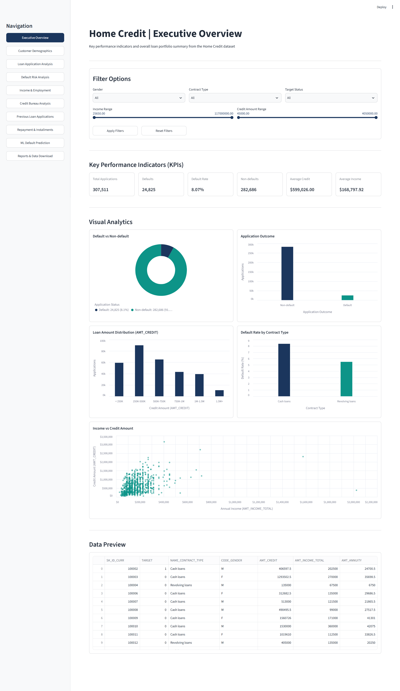
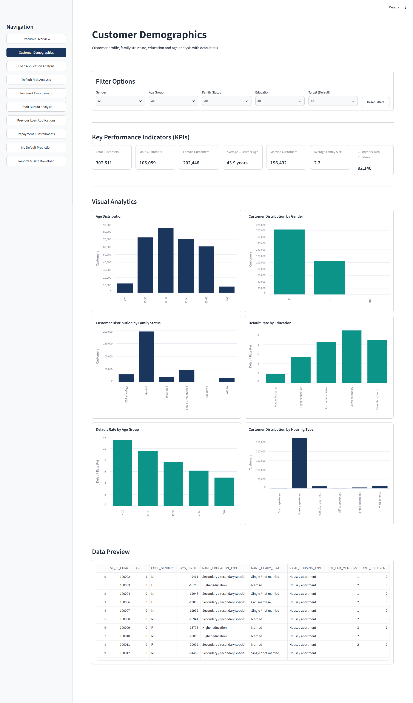
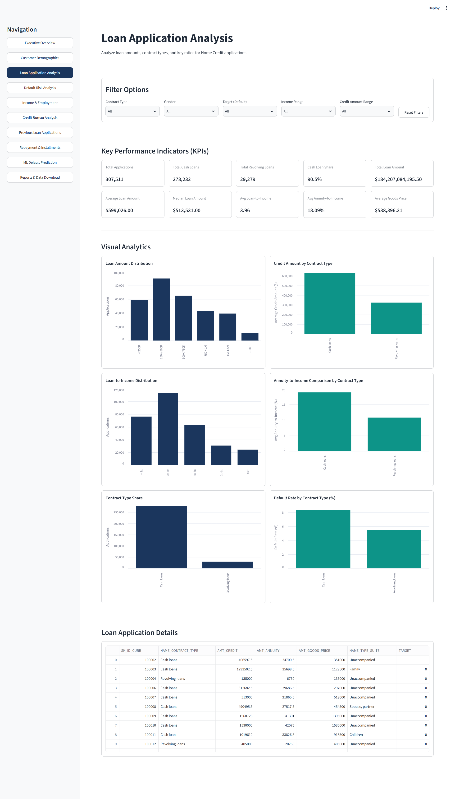
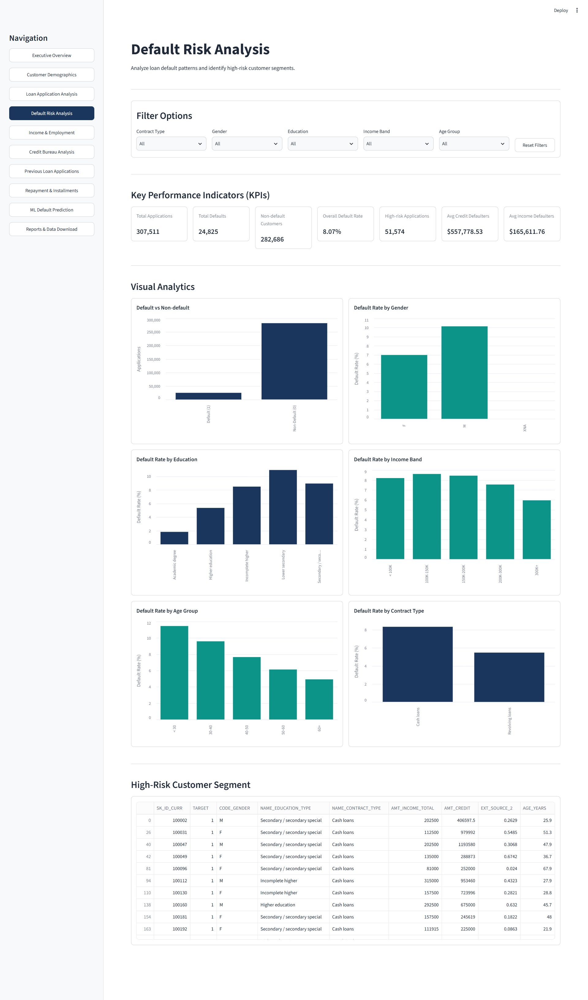
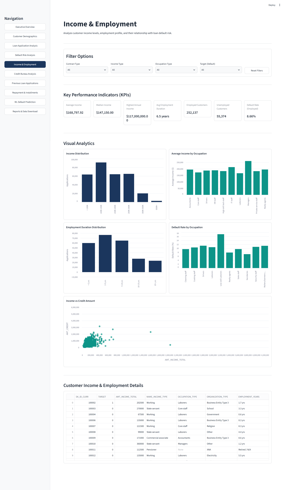
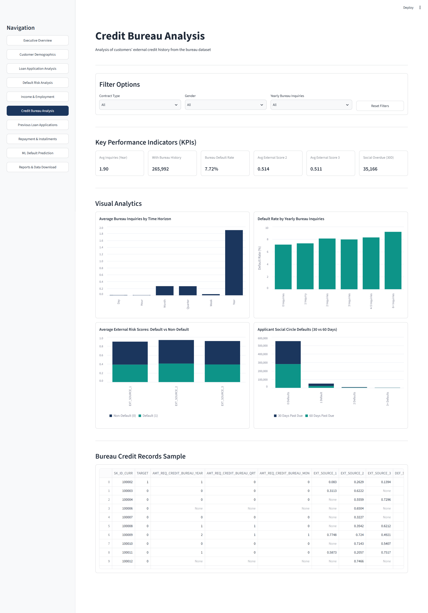
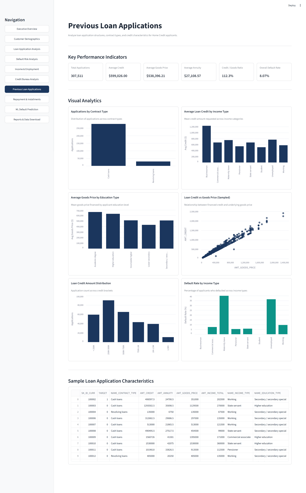
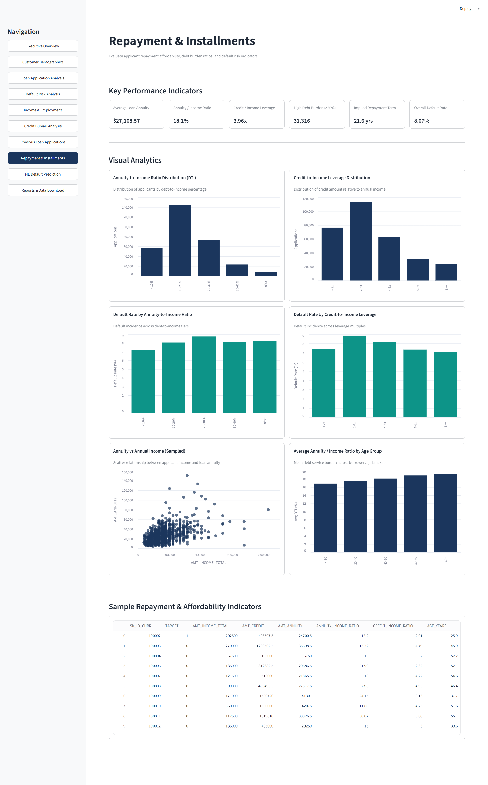
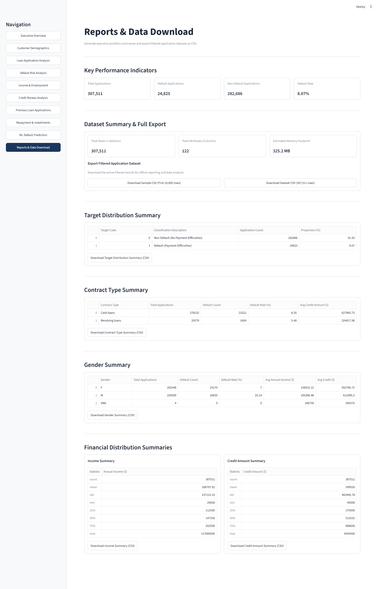

# Home Credit Risk Analytics Dashboard

## Project Overview

The **Home Credit Risk Analytics Dashboard** is a comprehensive, interactive multi-page web application built using **Streamlit** for analyzing consumer loan applications, portfolio default risks, and borrower creditworthiness. Powered by the Home Credit Default Risk application training dataset, this dashboard equips risk analysts, credit underwriters, and portfolio managers with actionable intelligence across applicant demographics, financial ratios, repayment burden, bureau inquiry behavior, and predictive machine learning models.

---

## Project Objectives

- **Analyze Loan Applications:** Evaluate total volumes, loan amount distributions, contract types, and portfolio default rates.
- **Understand Customer Demographics:** Profile applicants by age brackets, gender, family status, and education levels to identify borrower segments.
- **Examine Default & Risk Patterns:** Identify critical risk drivers, evaluate external credit scoring models (`EXT_SOURCE_2`, `EXT_SOURCE_3`), and highlight vulnerable loan categories.
- **Evaluate Income & Employment Stability:** Assess how income sources, occupational types, and employment duration correlate with repayment likelihood.
- **Assess Repayment Affordability:** Measure applicant debt service capability using Debt-to-Income (DTI / Annuity-to-Income), credit leverage, and implied loan tenures.
- **Predict Default Probability:** Provide an interactive Machine Learning default prediction tool with real-time customer risk scoring and model performance metrics.

---

## Dashboard Preview

Below are previews of the analytical pages available within the Home Credit Risk Analytics Dashboard:

### 1. Executive Overview
Comprehensive portfolio KPIs, interactive global filter controls, default rate breakdowns, and loan amount distributions.



---

### 2. Customer Demographics
Applicant demographic profiling across age brackets, gender ratios, educational attainment, and family composition with default rates.



---

### 3. Loan Application Analysis
Granular breakdown of loan contract types, credit-to-income affordability bands, annuity distributions, and goods price financing ratios.



---

### 4. Default Risk Analysis
Deep-dive into default risk concentration, high-risk customer segmentation, and external data source score distributions.



---

### 5. Income & Employment
Analysis of borrower income streams, employment duration, and occupational categories in relation to credit default risk.



---

### 6. Credit Bureau Analysis
Evaluation of external credit bureau inquiries across multiple time horizons (hourly, daily, weekly, monthly, and yearly) and inquiry risk correlation.



---

### 7. Previous Loan Applications
Examination of applicant historical credit requests, loan terms, annuity amounts, and contract structures recorded in the application profile.



---

### 8. Repayment Installments
Applicant repayment affordability analysis, debt burden ratios (Annuity-to-Income / DTI), leverage metrics, and implied loan maturity terms.



---

### 9. Reports & Data Download
Executive summary reporting, risk-segmented tabular summaries, and dynamic filtered dataset export capabilities with one-click CSV download.



---

## Dashboard Pages & Features

The dashboard provides 10 specialized analytical modules accessible through the sidebar navigation:

1. **Executive Overview (`01_Executive_Overview.py`):**
   Displays six high-level portfolio KPIs (Total Applications, Defaults, Default Rate, Non-defaults, Average Credit, and Average Income). Includes a global filtering panel (Gender, Contract Type, Target Status, Income Range, Credit Range), dynamic Altair distribution charts, and a real-time data preview.

2. **Customer Demographics (`02_Customer_Demographics.py`):**
   Explores borrower age demographics, gender distributions, educational backgrounds, and marital statuses to understand customer profiles and default probabilities.

3. **Loan Application Analysis (`03_Loan_Application_Analysis.py`):**
   Analyzes credit amount distributions, loan annuity payments, goods price financing, contract categories, and binned affordability brackets.

4. **Default Risk Analysis (`04_Default_Risk_Analysis.py`):**
   Focuses on identifying high-risk applicant segments, external credit bureau score distributions (`EXT_SOURCE_2`, `EXT_SOURCE_3`), and default risk indicators.

5. **Income & Employment (`05_Income_Employment.py`):**
   Investigates borrower income levels, primary income types (Working, Commercial Associate, Pensioner, State Servant), occupational roles, and years of employment.

6. **Credit Bureau Analysis (`06_Credit_Bureau_Analysis.py`):**
   Evaluates applicant credit inquiry counts from credit bureaus across various timeframes and assesses social circle payment defaults.

7. **Previous Loan Applications (`07_Previous_Loan_Applications.py`):**
   Synthesizes credit characteristics, average loan annuities, goods price ratios, and credit request structures from historical application records.

8. **Repayment & Installments (`08_Repayment_Installments.py`):**
   Computes repayment affordability metrics, including Debt-to-Income (DTI / Annuity-to-Income ratio), financial leverage (Credit-to-Income ratio), and implied loan tenure.

9. **ML Default Prediction (`09_ML_Default_Prediction.py`):**
   Features a supervised machine learning classification pipeline (StandardScaler + Logistic Regression) evaluated on holdout data. Displays evaluation metrics (Accuracy, Precision, Recall, F1-score), confusion matrix, feature coefficients, and an interactive loan scenario simulator.

10. **Reports & Data Download (`10_Reports_Data_Download.py`):**
    Generates structured executive reports, cross-tabulated risk segment summaries, and enables dynamic UTF-8 CSV exports of filtered application data.

---

## Technologies Used

- **Python:** Primary programming language.
- **Streamlit:** Interactive web application framework and UI rendering.
- **Altair:** Declarative statistical data visualizations and charts.
- **Pandas:** High-performance data manipulation, filtering, and aggregation.
- **NumPy:** Numerical computations and mathematical operations.
- **Scikit-learn:** Machine learning pipeline, feature scaling, model training, and performance metrics.

---

## Project Structure

```
Home_Credit_Risk_Analytics/
├── .streamlit/
│   └── config.toml                  # Streamlit visual theme and styling
├── dashboard_pages/
│   ├── 01_Executive_Overview.py     # Executive overview KPIs & global filters
│   ├── 02_Customer_Demographics.py  # Demographic and profile analysis
│   ├── 03_Loan_Application_Analysis.py # Loan amounts and affordability analysis
│   ├── 04_Default_Risk_Analysis.py  # Risk concentration & external scores
│   ├── 05_Income_Employment.py      # Income types, occupation & employment duration
│   ├── 06_Credit_Bureau_Analysis.py # Credit bureau inquiry analysis
│   ├── 07_Previous_Loan_Applications.py # Historical credit request characteristics
│   ├── 08_Repayment_Installments.py # Repayment affordability and debt burden
│   ├── 09_ML_Default_Prediction.py  # ML default risk prediction model & simulator
│   └── 10_Reports_Data_Download.py  # Executive reports & dynamic CSV export
├── data/
│   └── application_train.csv        # Primary dataset (local only; excluded from Git)
├── screenshots/
│   ├── credit_bureau_analysis.png
│   ├── customer_demographics.png
│   ├── default_risk_analysis.png
│   ├── executive_overview.png
│   ├── income_employment.png
│   ├── loan_application_analysis.png
│   ├── previous_loan_applications.png
│   ├── repayment_installments.png
│   └── reports_data_download.png
├── .gitignore                       # Git ignore rules for data, cache, and secrets
├── app.py                           # Main application entrypoint & state management
├── README.md                        # Project documentation and visual previews
└── requirements.txt                 # Python library dependencies
```

---

## Dataset

This dashboard is built on the **`application_train.csv`** dataset from the **Kaggle Home Credit Default Risk** competition:

- **Rows:** 307,511 loan applications
- **Columns:** 122 applicant, loan, and financial features
- **Target:** `TARGET` (`0` = Repaid without difficulty, `1` = Payment difficulties / default)

### Local Dataset Setup

Due to GitHub repository file size limits, the dataset is **not stored in the Git repository**. To run the dashboard locally:

1. Download `application_train.csv` from the [Kaggle Home Credit Default Risk competition page](https://www.kaggle.com/c/home-credit-default-risk/data).
2. Place the file inside the local `data/` folder:
   ```
   Home_Credit_Risk_Analytics/data/application_train.csv
   ```

---

## Installation & Setup

1. **Clone the repository:**
   ```bash
   git clone https://github.com/vandavasi-kumar/home-credit-risk-analytics.git
   cd home-credit-risk-analytics
   ```

2. **Create and activate a virtual environment (recommended):**
   ```bash
   # Windows (PowerShell)
   python -m venv .venv
   .venv\Scripts\Activate.ps1

   # Linux / macOS
   python3 -m venv .venv
   source .venv/bin/activate
   ```

3. **Install the dependencies:**
   ```bash
   pip install -r requirements.txt
   ```

4. **Verify dataset location:**
   Ensure `data/application_train.csv` is present in the `data/` directory.

---

## Running the Application

Start the Streamlit application using:

```bash
streamlit run app.py
```

The dashboard will open automatically in your browser at `http://localhost:8501`.

---

## Project Limitations

- **Single Source Dataset:** All dashboard analytics, aggregations, and predictive models are based strictly on `application_train.csv`.
- **Aggregated Historical Fields:** The project does not link supplementary relational Kaggle tables (such as `bureau.csv`, `previous_application.csv`, `POS_CASH_balance.csv`, or `installments_payments.csv`). All inquiry counts, previous application attributes, and repayment burden metrics utilize the aggregated summary features provided within the primary application file.

---

## Author

**Kumar Vandavasi**
